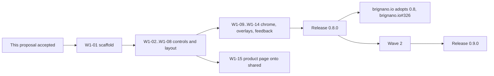

Status: proposed · Tracking issue: #45

# A shared component layer: `components.css` and page templates

## Why

`@brignano/design` ships tokens and one template (`product-page.css`). The
controls every surface needs (buttons, fields, messages, pills, cards, dialogs)
exist only on the preview pages, in `previews/_preview.css`, which is not in the
package. So every consumer rebuilds them, and they drift:

- brignano.io has about five hand-made button styles with different radii
  (`rounded-lg`, `rounded-xl`), and its chat send button disables itself with
  `opacity-40`, which DESIGN.md §4 forbids.
- `product-page.css` carries private copies of a button and a form field
  (`.pp-button`, `.pp-field`) that should be the shared ones.
- life, homelab and driftwood have nothing shared to adopt yet.

Anthony asked for the whole catalog up front, today's needs and likely future
ones, so each component's direction is decided before anyone builds it and the
backlog is visible. This proposal is that catalog. Each row becomes one issue.

## What changes for a consumer

```css
@import '@brignano/design/tokens.css';
@import '@brignano/design/components.css';      /* new: controls and patterns */
@import '@brignano/design/templates/app-shell.css'; /* new: one file per template */
```

```html
<button class="btn btn-primary">Save</button>
<div class="field">
  <label for="email">Email</label>
  <input id="email" type="email" aria-describedby="email-hint">
  <p class="field-hint" id="email-hint">We reply within a day.</p>
</div>
```

Each component also gets a preview page in `previews/` (both themes side by
side, as today) and a section in DESIGN.md.

## Global decisions (apply to every component issue)

Each has a recommendation. Accepting the proposal accepts all of them unless
Anthony says otherwise.

| # | Question | Recommendation | Rejected, and why |
|---|---|---|---|
| G1 | How is it shipped? | **Plain CSS classes**, no JS and no build step. Works in Next.js, static Workers and plain HTML alike. | React wrappers: only helps React sites, adds a build, tests and a React peer dep to version. A consumer can wrap classes in a few lines if it wants. |
| G2 | One file or many? | **`components.css`** for controls and patterns (one import, ~20 KB unminified is fine). **`templates/<name>.css`** per page template, so a site pays only for the templates it uses. | One file per component: too many imports for consumers to keep right. |
| G3 | Class names | **Short and unprefixed** (`.btn`, `.field`, `.msg`, `.pill`), matching the preview pages, inside **`@layer brignano.components`** so a consumer's own CSS and Tailwind utilities always win without `!important`. Variants are `.btn-primary`; states use real attributes (`disabled`, `aria-invalid`, `aria-current`, `aria-expanded`, `[open]`), never state classes. | `ds-` prefix: noisy, and the layer already prevents the clash that matters (who wins). BEM: heavier than the system needs. |
| G4 | Behaviour | **Native platform first**: `<dialog>`, the `popover` attribute, `<details>`, CSS anchor positioning with a fallback, `:has()`. Where a component needs JS (toast queue, tabs keyboard handling), design ships the CSS and documents the ARIA contract; the consumer owns the JS. | Shipping a JS runtime: a second package in all but name. |
| G5 | Product page | `.pp-button` and `.pp-field` become aliases of `.btn` and `.field`, then are removed at 1.0. No visual change to existing product pages. | Leaving them separate: the drift this layer exists to stop. |
| G6 | Tiers | Components read the tier from the existing tokens (size and spacing scale up under `.tier-marketing`); no per-tier classes. | Separate marketing/tool components: same design, two copies. |
| G7 | Gates | `npm run check` extended: every class in `components.css` appears on a preview page, no hex outside `tokens.css`, contrast of every text/background pair ≥ 4.5:1 (3:1 for control edges) in both themes. | Visual regression screenshots: worth it later, not on day one. |
| G8 | Release | One minor release per wave (wave 1 → 0.8.0, wave 2 → 0.9.0), cut only on Anthony's "publish". Names may still move until 1.0. | Releasing per component: churn for consumers. |
| G9 | Build rule | A wave-3 component is not built until a product needs it; its issue holds the decided direction so building it later is quick. | Building all of it now: untested, unused components drift. |

## The catalog

Wave 1 is what every surface already rebuilds by hand. Wave 2 is useful soon
but has few users today. Wave 3 is the "decide now, build on first real need"
backlog. Every item is size S unless marked M. Each row's recommendation becomes
the Decisions section of its issue.

### Wave 1 — controls and patterns every site rebuilds (p1)

| ID | Component | What it covers | Recommendation | Issue |
|---|---|---|---|---|
| W1-01 | Layer scaffold | `components.css` export, `@layer brignano.components`, preview page template, `check.mjs` gates from G7, DESIGN.md §14 "Components". | Lands first; every other issue builds on it. | #46 |
| W1-02 | Button and link | `.btn` + primary, secondary, ghost, danger; sizes sm/md/lg; icon-only (`.btn-icon`, requires `aria-label`); loading (`aria-busy="true"` shows a spinner, keeps width); full-width on phone; `.link` for prose. | Disabled is neutral (`--i-disabled-*`), never opacity. Danger is the only non-cobalt fill. One radius: `--radius`. | #47 |
| W1-03 | Text fields | `.field` wrapper with label, hint, error; input, textarea, select; prefix/suffix adornments; required and optional markers; `aria-invalid` drives the error state. | Optional fields are marked "(optional)", required ones are not starred (fewer marks, the product-page convention). Error text always pairs with the danger icon. | #48 |
| W1-04 | Choice controls | Checkbox and radio (native, `accent-color`), checkbox/radio groups in a `<fieldset>`, switch (`<input type="checkbox" role="switch">`), segmented control (radio group styled as buttons). | Switch only for settings that apply immediately; anything submitted with a form is a checkbox. | #49 |
| W1-05 | Message and banner | Promote preview `.msg` (info, success, attention, danger) with icon and a word; dismissible variant; page-wide `.banner` above the header. | Info uses neutral + cobalt icon, not a fourth hue. | #50 |
| W1-06 | Pill, badge, tag | Promote preview `.pill`; status pill (dot + word); count badge on an icon button; removable tag (filter chips). | Status pills always carry a word, never colour alone. | #51 |
| W1-07 | Card | Static card, link card (whole card clickable via a stretched link, one focus ring), media card (image first). | Elevation per theme as DESIGN.md §6: hairline + shadow in light, lighter surface in dark. | #52 |
| W1-08 | Layout primitives | `.container` (tier measure), `.stack` (vertical rhythm), `.cluster` (wrapping row), `.grid` (auto-fit columns), `.section` (tier section rhythm), `.divider`. | Gap-based only, sizes from `--s*`. No 12-column grid. | #53 |
| W1-09 | Site header, nav and footer | Sticky header on `--surface-sticky` with blur; primary nav with `aria-current`; mobile menu as a popover sheet; skip link; footer with link columns and legal line. | Mobile nav is a popover (G4), no hamburger JS. One header, both tiers. | #54 |
| W1-10 | Dialog and sheet | Native `<dialog>`: modal, confirm (destructive action names the action on the button), side sheet and bottom sheet on phone. | Focus returns to the opener; the close button is always visible; no dialog on top of a dialog. | #55 |
| W1-11 | Popover and menu | `popover` attribute + anchor positioning (fallback: below the trigger); action menu with `role="menu"` contract; the holiday popover on brignano.io is the first consumer. | Menu items are buttons or links, never divs. | #56 |
| W1-12 | Tooltip | Short label on hover and focus for icon-only buttons; `popover="hint"` where supported, CSS fallback. | Tooltips only name things; anything longer is a popover. Never on touch-only content. | #57 |
| W1-13 | Toast | Toast region (bottom on phone, bottom-right on desktop), success/attention/danger, optional action, `role="status"` / `role="alert"` contract. | Auto-dismiss only for success, after 5s, paused on hover/focus. Errors stay until dismissed. | #58 |
| W1-14 | Loading and empty states | Spinner, skeleton blocks (respects reduced motion), progress bar and meter (native `<progress>`/`<meter>`), empty state (icon, one line, one action). | Skeletons only for layouts known in advance; otherwise a spinner. | #59 |
| W1-15 | Product page onto shared controls | `.pp-button` → `.btn`, `.pp-field` → `.field`, as aliases (G5). Preview pages switch to the package classes and `_preview.css` drops its copies. | No visual change; the fold check must still pass on both example pages. | #60 |

### Wave 2 — data, navigation and page templates (p2)

| ID | Component | What it covers | Recommendation | Issue |
|---|---|---|---|---|
| W2-01 | Table | Data table with tabular figures, numeric columns right-aligned, sortable header style (`aria-sort`), row hover, sticky header, horizontal scroll on phone with a shadow edge. | Phone: scroll the table, don't stack rows into cards (keeps columns comparable). | #61 |
| W2-02 | Key-value list and stat tile | `<dl>` key-value list (receipts, settings summaries), stat tile (mono number, label, optional delta with icon + word). | Deltas use success/danger only when up/down is good/bad for the reader; otherwise neutral. | #62 |
| W2-03 | Tabs | Tab list, tab panel, ARIA contract (`role="tablist"`, arrow keys); underline style. | Tabs switch views of one thing; never for navigation between pages (use nav). | #63 |
| W2-04 | Breadcrumb and pagination | Breadcrumb with `aria-current="page"`; pagination (prev/next + numbers, collapses to prev/next on phone). | Prefer "Load more" over numbered pages on content lists; numbered for tables. | #64 |
| W2-05 | Disclosure and accordion | `<details>`/`<summary>` styled, grouped accordion (FAQ), chevron that rotates (reduced-motion aware). | Native `<details name="…">` for exclusive accordions; no JS. | #65 |
| W2-06 | Small content pieces | Avatar (image, initials fallback), `kbd`, inline code, code block (shiki-neutral token colours), blockquote, figure + caption. | Code block colours from the neutral ramp + cobalt only, not a syntax rainbow. | #66 |
| W2-07 | Prose | `.prose` for long-form: headings, lists, links, tables, code, images, footnotes, within the tier measure. | Replaces Tailwind Typography in brignano.io's blog. | #67 |
| W2-08 | Template: app shell (M) | Tool-tier layout: header, collapsible sidebar nav, content area, optional right panel; sidebar becomes a sheet on phone. For life, homelab, driftwood. | Needs a short design pass before build (size M). | #68 |
| W2-09 | Template: settings page | Sections with heading + description on the left, fields on the right (stacked on phone); save bar; danger zone. | Save per section, not one global save. | #69 |
| W2-10 | Template: legal page | Privacy policy and terms layout: prose, last-updated date, table of contents for long pages. Needed by every site with a lead form. | Layout only; the wording is each product's. | #70 |
| W2-11 | Template: error pages | 404, 500 and offline: one line of what happened, one way forward, the product mark. | No jokes or illustrations; calm (DESIGN.md §1). | #71 |
| W2-12 | Template: article and docs page | Article (title, date, reading time, prose, next/previous) and docs page (left nav, on-this-page list, prose). | One template, docs adds the two navs. | #72 |
| W2-13 | Template: changelog page | Releases newest first, version + date in mono, sections (Added/Changed/Fixed), anchor per release. Matches the fleet's hand-written release notes. | Reads `releases/*.md` structure; no "Unreleased" section. | #73 |
| W2-14 | Email template | Transactional email (lead auto-reply, owner notification): table-based HTML, inline styles from token values, light only, plain-text twin. For the fleet lead standard. | Generated by a script from tokens so hexes still live in one place. | #74 |

### Wave 3 — decided now, built on first real need (p3)

| ID | Component | What it covers | Recommendation | Issue |
|---|---|---|---|---|
| W3-01 | Combobox / autocomplete | Text input with a filtered listbox. | Start with native `<datalist>`; build a full ARIA combobox only when a product needs async results. | #75 |
| W3-02 | Date and time input | Styling for native `date`, `time`, `datetime-local`; date range as two fields. | Native inputs only; no custom calendar widget. | #76 |
| W3-03 | File upload | Dropzone over a native file input, file list with progress and remove. | Native input stays clickable and keyboard reachable. | #77 |
| W3-04 | Command palette | ⌘K dialog with search and grouped results; builds on dialog + combobox. | Only for tool-tier apps with many actions; brignano.io keeps its shortcuts help. | #78 |
| W3-05 | Stepper / multi-step form | Step indicator (numbered, current, done) and step layout with back/next. | Prefer one page; use steps only past ~8 fields. | #79 |
| W3-06 | Timeline and activity feed | Vertical timeline (work history, trip days), activity feed with timestamps in mono. | One component, two densities by tier. | #80 |
| W3-07 | Range slider | Styled native range with value label. | `accent-color` first; custom track only if contrast fails. | #81 |
| W3-08 | Calendar / agenda view | Month grid and agenda list for life (trips, events). | Agenda list first; month grid only if life needs it. | #82 |
| W3-09 | Social share image template | Open Graph / Twitter card layout (1200×630) from tokens: title, mark, product glyph. | One template rendered by each site's OG route. | #83 |
| W3-10 | Pricing table | Plan columns with features and one recommended plan; extends the product page's price list. | Only when a product has more than one paid plan. | #84 |

### Considered and not planned

Each would be its own issue only if a product needed it; recorded so the
question isn't reopened by accident.

- **Carousel.** Hides content and fails on keyboard and screen readers. Use a
  scroll-snap row of cards (W1-07 + W1-08) instead.
- **Rich text editor.** A product, not a component; use a library inside the
  app that needs it.
- **Custom select / dropdown replacing `<select>`.** Native select is styled in
  W1-03; a custom one is only W3-01.
- **Sign-in page.** Sites are behind Cloudflare Access, which owns that screen.
- **Charts as components.** `tokens.chart.css` already gives colour; chart
  libraries render them.

## Order of work



## Cost

- **Build:** wave 1 is 15 small PRs, wave 2 is 13 small and 1 medium. Wave 3
  costs nothing until a product asks.
- **Running:** none. Static CSS in an npm package and on design.brignano.io.
- **Maintenance:** one CSS file plus templates, gated by `npm run check`.
  Consumers drop their own copies, so total CSS across the fleet goes down.

## Open questions for Anthony

Everything above has a recommendation. The ones most worth a conscious look:

1. **G1, CSS only.** Accept, or also ship React wrappers.
2. **G3, unprefixed names in a cascade layer.** Accept, or prefix with `ds-`.
3. **W2-08, app shell.** Keep in wave 2, or pull into wave 1 if a life or
   homelab UI rebuild is coming soon.
4. **W2-14, email template in design.** Accept, or leave emails to each product.
