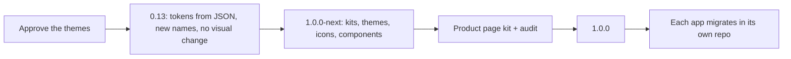

Status: proposed · Tracking issue: #171

# Design v1.0: a look of our own, a finished system, and apps that can't drift

## Why

The engineering under this system is sound: measured contrast, 13 automated
checks, a docs page for every component. What it lacks is a look and an end.

- **It reads as the default stack.** Geist, a blue primary, stock Lucide icons
  and 12px white cards are what most new apps ship with. On a tool screen the
  only thing that is ours is the `A|B` stamp in the footer.
- **Icons are 46 unmodified Lucide files.** No selected variant, no product
  marks in the set, no illustration.
- **It isn't finished.** Ten components are still "planned" (#75–#84).
- **The tokens are one hand-written CSS file** with terse names (`--i`,
  `--n-300`, `--s4`). No tool can read them, and a component can't be themed
  without overriding the colour underneath it.
- **Nothing stops an app from deviating.** Every check runs in this repo only.

Anthony's calls: re-found the identity rather than evolve it, mock first, and
ship the result as a breaking v1.0 (2026-11-21); one house look plus a theme
per product, so the apps differ from one another (2026-11-22).

## Wireframe

[`previews/wireframes/design-v1.html`](../previews/wireframes/design-v1.html)
draws, at 390px and 1280px:

- **five products, each on its own signature screen**: homelab as a console
  of tiles, Driftwood as a map with a diff, Guidebook as a guide's steps,
  Sites as a conversation beside the live site, Receipts as a month you read
  like a page;
- **the design site's new home**, working: tap a product to re-theme the
  screen, or build a theme and read the file it makes;
- **the three kits** the themes are built from, each on Sites' product page
  and homelab's Hosts view, with light and dark specimens.

## One house, a theme per product

Decided 2026-11-22. One look for every app would make them alike again, which
is today's problem with cobalt and Geist. So the system has two layers.

**The house** is what makes everything recognisably ours, and no theme can
change it: the layout, how every control behaves, mono for data, the
`product | section` bar above each heading (the bar from `A|B`), the `A|B`
stamp, and the accessibility floor.

**A theme** is everything else, and each product has its own. It is a small
file, not CSS:

```yaml
# sites.theme
kit: larch            # split, ledger or larch
ground: wash          # plain, bright or wash
hue: 355              # what acts: buttons, links, the selected item
heading-weight: 500
corners: 16
```

The system generates the full palette, light and dark, from those values and
refuses a theme whose colours fail contrast. Adding a product is choosing a
few values; it never adds a component or a rule.

### A shell per product, so the shape differs too

The first drawing put every product on the same sidebar, four stats and a
table, in five skins. Anthony's verdict: "still really cookie cutter". Colour
and type alone don't make two apps different; the shape of the main screen
does. So a theme also names a **shell**, and the system ships five:

| Shell | The main screen is | First used by |
|---|---|---|
| **Console** | a grid of large tiles, one per thing you watch, no sidebar | homelab |
| **Canvas** | a full-bleed map or diagram, with an inspector beside it | Driftwood |
| **Player** | one thing's steps in order, with a preview of the current one | Guidebook |
| **Conversation** | a thread and a composer, with the result shown beside it | Sites |
| **Document** | a single centred page you read top to bottom | Receipts |

A shell is a template in this repo (like today's `app-shell.css`), built from
the shared components, so two products on the same shell still behave the
same. The rule that goes with it: **a product's main screen is built around
the one thing the product does**, the way its marketing page already is
(ADR-0017's "the page does the thing"). The sidebar-and-table layout stays for
settings and lists, where it belongs, and is no longer the default first
screen.

### The three kits

A kit sets the character a theme starts from.

| | Split (the house default) | Ledger | Larch |
|---|---|---|---|
| **In a line** | The `A\|B` bar becomes the system | A well-kept notebook | Soft and friendly |
| **Headings** | Archivo, wide and heavy, capitals | Newsreader, a serif | Bricolage Grotesque |
| **Interface** | Archivo at normal width | Instrument Sans | Onest |
| **Data** | Martian Mono | IBM Plex Mono | IBM Plex Mono |
| **Corners** | square | 3px | pills and 20px cards |
| **Separation** | 1px ink borders | hairline rules, no cards | tint, no borders |
| **Status** | a coloured bar and a word | an outlined stamp | a soft tinted pill |
| **Selected** | inverted | a rule at the edge | tinted, icon filled |
| **Icon stroke** | 1.5px, square ends | 1.5px, flat ends | 1.75px, round ends |

All typefaces are open-licensed (SIL OFL) and self-hosted. An app loads only
its own kit's fonts: about 115 KB for Split, 150 KB for Ledger, 75 KB for
Larch.

### Who gets what

| Product | Kit | Shell | What its theme changes | Why |
|---|---|---|---|---|
| homelab | Split | Console | nothing: the house look, lime signal | dense, glanceable |
| life, brignano.io, this site | Split | undecided | nothing | the family's own face |
| Driftwood | Split | Canvas | always dark, all mono, teal signal | it already reads as an incident console (ADR-0017) |
| Guidebook | Larch | Player | bright ground, violet, 800-weight headings | loud and friendly, for new hires |
| Sites | Larch | Conversation | pink wash, magenta, medium headings, rounder | soft, for local businesses |
| Receipts | Ledger | Document | nothing yet | money and records suit paper and a serif |
| Breakeven, Card | undecided | undecided | | |

These follow the marks and choices each product already has (teal, violet,
magenta; ADR-0017), so a product's app now matches its marketing page.
Receipts, Breakeven and Card are my suggestions and easy to change.

### Why Split is the house

- It is the only look that comes from something already ours: the bar in
  `A|B` becomes a rule the whole system follows.
- It is the most minimal: two font files, no shadows, no radius scale, one
  signal colour, so green, amber and red stay free for state.
- It suits the tools, which are mostly dense tables and mono data.

It is also the least friendly, which is why the products meant for the public
(Sites, Guidebook) take Larch instead.

### Measured

Text contrast, light / dark, against WCAG's 4.5:1 (3:1 for a control's edge).
Driftwood is dark only.

| Pair | Split | Ledger | Larch | Driftwood | Guidebook | Sites |
|---|---|---|---|---|---|---|
| Body text on the page | 18.31 / 17.40 | 16.37 / 15.64 | 14.85 / 15.89 | 17.49 | 17.41 / 17.03 | 14.92 / 16.46 |
| Muted text on a surface | 6.00 / 6.85 | 5.88 / 6.41 | 5.81 / 6.71 | 6.90 | 6.02 / 7.23 | 7.23 / 7.12 |
| Primary button label | 14.82 / 14.82 | 16.37 / 15.64 | 8.45 / 11.05 | 12.25 | 6.39 / 9.96 | 6.42 / 9.47 |
| Lowest state word on a surface | 6.20 / 7.42 | 6.82 / 7.88 | 5.77 / 7.90 | 7.47 | 6.11 / 8.29 | 6.66 / 7.93 |
| Control edge on the page | 18.31 / 17.40 | 3.65 / 4.01 | 3.85 / 4.73 | 17.49 | 4.14 / 5.21 | 4.08 / 4.97 |

One known exception: Split's lime fill is 1.24:1 against a white page, so in
light mode the button is found by its ink border (18.31:1), not its fill. The
wireframe draws it that way.

### What theming costs

- More combinations to keep accessible. The generator and `npm run check`
  measure every theme, so this is machine work, not review work.
- Five shells to build and keep, instead of one app shell. This is the real
  cost of not being cookie cutter, and the main addition to the build.
- Three kits to maintain instead of one look. Each kit is a set of token
  values over the same components, not a second set of components.
- A shared component has to look right in all three kits, so each component's
  preview page shows it in each.

## What v1.0 is

Six pieces, built in this order. Each becomes its own issues once this is
accepted.

### 1. Tokens that tools can read

- One source, `tokens/*.json`, in the W3C design-tokens format. A script
  generates `tokens.css`, `tailwind.css`, the email tokens and a typed list of
  names from it. The generated files stay committed, so a consumer still
  imports plain CSS and nothing changes for them.
- Three tiers with readable names: **primitive** (`--neutral-300`),
  **semantic** (`--text-muted`, `--action-fill`), **component**
  (`--button-radius`, `--card-edge`). Components read only component and
  semantic tokens, so a product can restyle a button without touching a colour.
- Today's names (`--i`, `--n-300`, `--s4`) stay as aliases for one minor
  release, marked deprecated, then go in 1.0.

### 2. The house, the kits and the themes, as tokens

Colour, type, shape, elevation and motion values for the three kits, the theme
file format and its generator, and one theme per product,
with a full type scale (size, line height and tracking as one token per step),
a density setting for tool screens, and a named motion scale. Every value is
measured and checked the way `npm run check` does today.

### 3. An icon set of our own

Decided 2026-11-21: an open-source base redrawn to our rules, not a different
stock set and not drawn from scratch.

- One stroke, end and join rule per kit, applied to every icon by a script and
  enforced by the check.
- Grow from 46 to about 120, added by need: the apps' own navigation first.
- A filled variant for the selected state.
- Product marks (Driftwood, Guidebook, Sites and the rest) and a small set of
  signature icons drawn by hand on the same grid, plus `A|B`.

### 4. Completeness

- Restyle every existing component and template to the new tokens.
- Build the ten planned components (#75–#84): combobox, date and time inputs,
  file upload, command palette, stepper, timeline, range slider, calendar,
  social share image, pricing table.
- Add what the audit of the apps turns up that isn't here yet (avatar, empty
  state art, a chart frame).
- Rebuild the gallery's home as drawn in the wireframe: a product switcher
  that re-themes a real screen, a theme builder, components shown inside real
  screens, and search. Today it is a wall of 40 cards.

### 5. A product page kit

The three product pages share one skeleton today: a headline with one
highlighted word, three steps, a form. ADR-0017 gave each product five choices
of its own; the kit gives them different parts to choose from.

- A library of sections (several heroes, proof formats, comparison, pricing,
  questions, closing asks) rather than one fixed order.
- An art-direction brief per product next to its `BRIEF.md`, so the look is
  decided in words before a page is built.
- The rules that work stay: brief first, show then tell, one primary action,
  the word budgets, the stranger test.

### 6. Governance: change the system, not the app

- **`npx @brignano/design audit`** runs in each app's CI and fails on a colour
  literal, a font, radius, shadow or spacing value that isn't a token, a
  Tailwind arbitrary colour, or a token name that doesn't exist.
- **One escape hatch:** `/* design-exception: brignano/design#123 */` beside
  the line. The audit passes it while that issue is open and fails it once the
  issue closes, so an exception can't outlive the fix.
- **The rule, in DESIGN.md §12:** if an app needs something the system doesn't
  have, it files an issue here and waits or takes an exception. It never
  styles around the gap.
- **Drift report:** the fleet's weekly backlog check lists each app's design
  version and open exceptions.

## How it rolls out



- 0.13 changes no pixels, so apps can take it at once and start using the new
  names.
- 1.0 prereleases go to the `next` npm tag; the gallery shows them; no app
  moves until 1.0.0.
- Each app's migration is an issue in its own repo, filed when 1.0.0 is out.

## What it costs

- **Build:** large. About 30 to 40 size S and M issues across the six pieces,
  five of them the shells.
- **Running:** nothing. Static files on the existing Worker; fonts self-hosted.
- **Maintenance:** one new build step (the token generator) and an icon set we
  now own. The audit removes more upkeep than both add, because drift is
  caught in CI instead of in review.

## Rejected

- **One look for every app:** simplest, but the apps would look alike again.
- **Evolve the current look** (keep Geist and cobalt, add a display face):
  Anthony turned it down; it would still read as the default stack.
- **A dark-only console look:** Driftwood's product page already owns it.
- **Glass, gradients and glow:** dates fast and costs contrast.
- **Switch to another stock icon set:** quick, but still someone else's look.
- **A fully custom icon set:** too slow to hold quality across 100+ icons.
- **React components:** ADR-0012 stands; plain CSS reaches every app.
- **A hosted token service or Figma as the source:** a JSON file in this repo
  costs nothing to run and is reviewed like code.

## Open questions

1. **Are the kits and shells assigned to the right products?** Recommended: as
   in "Who gets what". Receipts' screen is a guess at what the app shows;
   Breakeven, Card, life and brignano.io are undecided.
2. **Tokens generated from JSON, with a build step in this repo?** Recommended:
   yes. Themes need a generator either way, so this is close to settled.

Settled: Split is the house (2026-11-22). Product pages keep their five
choices (ADR-0017); a product's theme now supplies them.

## Proposed issues

Filed once this is accepted, each with Decisions taken from here.

1. Tokens: JSON source, generator, three tiers, old names as aliases (0.13)
2. Foundations: the three kits' colour, type, shape, motion (1.0.0-next)
2a. Themes: the file format, the generator and its contrast gate; one theme per product
2b. Shells: console, canvas, player, conversation, document, one issue each, wireframed first
3. Icons: the stroke rule and check; the selected variant
4. Icons: grow the set to what the apps use; product marks
5. Components: restyle the existing set, one issue per gallery section
6. Components: the ten planned (#75–#84 move from "later" to ready)
7. Gallery: a real home page
8. Product page kit: sections library and the art-direction brief
9. Audit: the command, the exception comment, the docs
10. Fleet: an audit workflow apps can call (brignano/ai-tools)
11. Release 1.0.0, then one migration issue per app
