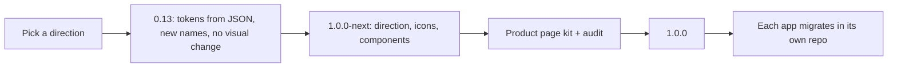

Status: proposed · Tracking issue: #171

# Design v1.0: a look of our own, a finished system, and apps that can't drift

## Why

The engineering under this system is sound: measured contrast, 13 automated
checks, a docs page for every component. What it lacks is a look and an end.

- **It reads as the default stack.** Geist, a blue primary, stock Lucide icons
  and 12px white cards are what most new apps ship with. On a tool screen the
  only thing that is ours is the `A|B` stamp in the footer.
- **Icons are 46 unmodified Lucide files.** No selected variant, no product
  marks in the set, no illustration.
- **It isn't finished.** Ten components are still "planned" (#75–#84).
- **The tokens are one hand-written CSS file** with terse names (`--i`,
  `--n-300`, `--s4`). No tool can read them, and a component can't be themed
  without overriding the colour underneath it.
- **Nothing stops an app from deviating.** Every check runs in this repo only.

Anthony's call on 2026-11-21: re-found the identity rather than evolve it,
mock the directions first, and ship the result as a breaking v1.0.

## Wireframe

[`previews/wireframes/design-v1.html`](../previews/wireframes/design-v1.html)
draws three candidate identities on the same two screens, Sites' product page
and homelab's Hosts view, at 390px and 1280px, with a light and dark specimen
of each. The words and layout are identical in all three; only the candidate
tokens change.

## The three directions

| | 1. Ledger | 2. Split | 3. Larch |
|---|---|---|---|
| **In a line** | A well-kept notebook | The `A\|B` bar becomes the system | Larch, forest and rust made visible |
| **Ground** | warm paper | white, or near-black | cream, or deep green at night |
| **What acts** | ink (a black button) | one lime signal on the primary action | forest green |
| **Highlight** | amber, as a highlighter | the same lime | amber |
| **Headings** | Newsreader, a serif | Archivo, wide and heavy, capitals | Bricolage Grotesque |
| **Interface** | Instrument Sans | Archivo at normal width | Onest |
| **Data** | IBM Plex Mono (kept) | Martian Mono | IBM Plex Mono (kept) |
| **Corners** | 3px | square | pills and 20px cards |
| **Separation** | hairline rules, no cards | 1px ink borders | tint, no borders |
| **Status** | an outlined stamp | a coloured bar and a word | a soft tinted pill |
| **Selected** | a rule at the edge | inverted | tinted, icon filled |
| **Icon stroke** | 1.5px, flat ends | 1.5px, square ends | 1.75px, round ends |
| **New font files** | 3 (about 150 KB) | 2 (about 115 KB) | 2 (about 75 KB) |

All typefaces are open-licensed (SIL OFL) and self-hosted; nothing is fetched
from a third party.

### Recommendation: Split

- **It is the only one that comes from something already ours.** The bar in
  `A|B` turns into a rule the whole system follows: a label and its value, a
  place and its page, a status and its word. Ledger and Larch are good looks
  that another studio could also have.
- **It is the most minimal.** Two font files, no shadows, no radius scale, one
  accent. Fewer tokens to maintain and fewer ways for an app to get it wrong.
- **It keeps colour meaning what it means today.** Lime is used for the one
  primary action and the one highlight, so green, amber and red stay free for
  state, which is the rule this system was built on.
- **It suits the tools.** Dense tables and mono data are most of what homelab,
  driftwood and life show.

What it costs: it is the least friendly of the three, and capitals on every
heading are loud. Product pages keep their own five choices (ADR-0017), so
Sites can still be soft and pink. If it feels too hard on a real screen, Larch
is the fallback, and Split's bar motif would carry over to it.

### Measured

Text contrast for every candidate pair, light / dark, against WCAG's 4.5:1
(3:1 for a control's edge):

| Pair | Ledger | Split | Larch |
|---|---|---|---|
| Body text on the page | 16.37 / 15.64 | 18.31 / 17.40 | 14.85 / 15.89 |
| Muted text on a surface | 5.88 / 6.41 | 6.00 / 6.85 | 5.81 / 6.71 |
| Primary button label | 16.37 / 15.64 | 14.82 / 14.82 | 8.45 / 11.05 |
| Highlight label | 10.79 / 7.04 | 14.82 / 14.82 | 9.91 / 8.04 |
| Lowest state word on a surface | 6.82 / 7.88 | 6.20 / 7.42 | 5.77 / 7.90 |
| Control edge on the page | 3.65 / 4.01 | 18.31 / 17.40 | 3.85 / 4.73 |

One known exception: Split's lime fill is 1.24:1 against a white page, so in
light mode the button is found by its ink border (18.31:1), not its fill. The
wireframe draws it that way.

## What v1.0 is

Five pieces, built in this order. Each becomes its own issues once this is
accepted.

### 1. Tokens that tools can read

- One source, `tokens/*.json`, in the W3C design-tokens format. A script
  generates `tokens.css`, `tailwind.css`, the email tokens and a typed list of
  names from it. The generated files stay committed, so a consumer still
  imports plain CSS and nothing changes for them.
- Three tiers with readable names: **primitive** (`--neutral-300`),
  **semantic** (`--text-muted`, `--action-fill`), **component**
  (`--button-radius`, `--card-edge`). Components read only component and
  semantic tokens, so a product can restyle a button without touching a colour.
- Today's names (`--i`, `--n-300`, `--s4`) stay as aliases for one minor
  release, marked deprecated, then go in 1.0.

### 2. The chosen direction, as tokens

Colour, type, shape, elevation and motion values from the chosen direction,
with a full type scale (size, line height and tracking as one token per step),
a density setting for tool screens, and a named motion scale. Every value is
measured and checked the way `npm run check` does today.

### 3. An icon set of our own

Decided 2026-11-21: an open-source base redrawn to our rules, not a different
stock set and not drawn from scratch.

- One stroke, end and join rule from the chosen direction, applied to every
  icon by a script and enforced by the check.
- Grow from 46 to about 120, added by need: the apps' own navigation first.
- A filled variant for the selected state.
- Product marks (Driftwood, Guidebook, Sites and the rest) and a small set of
  signature icons drawn by hand on the same grid, plus `A|B`.

### 4. Completeness

- Restyle every existing component and template to the new tokens.
- Build the ten planned components (#75–#84): combobox, date and time inputs,
  file upload, command palette, stepper, timeline, range slider, calendar,
  social share image, pricing table.
- Add what the audit of the apps turns up that isn't here yet (avatar, empty
  state art, a chart frame).
- Rebuild the gallery's index as a real home page instead of a wall of 40 cards.

### 5. A product page kit

The three product pages share one skeleton today: a headline with one
highlighted word, three steps, a form. ADR-0017 gave each product five choices
of its own; the kit gives them different parts to choose from.

- A library of sections (several heroes, proof formats, comparison, pricing,
  questions, closing asks) rather than one fixed order.
- An art-direction brief per product next to its `BRIEF.md`, so the look is
  decided in words before a page is built.
- The rules that work stay: brief first, show then tell, one primary action,
  the word budgets, the stranger test.

### 6. Governance: change the system, not the app

- **`npx @brignano/design audit`** runs in each app's CI and fails on a colour
  literal, a font, radius, shadow or spacing value that isn't a token, a
  Tailwind arbitrary colour, or a token name that doesn't exist.
- **One escape hatch:** `/* design-exception: brignano/design#123 */` beside
  the line. The audit passes it while that issue is open and fails it once the
  issue closes, so an exception can't outlive the fix.
- **The rule, in DESIGN.md §12:** if an app needs something the system doesn't
  have, it files an issue here and waits or takes an exception. It never
  styles around the gap.
- **Drift report:** the fleet's weekly backlog check lists each app's design
  version and open exceptions.

## How it rolls out

- 0.13 changes no pixels, so apps can take it at once and start using the new
  names.
- 1.0 prereleases go to the `next` npm tag; the gallery shows them; no app
  moves until 1.0.0.
- Each app's migration is an issue in its own repo, filed when 1.0.0 is out.

## What it costs

- **Build:** large. About 25 to 35 size S and M issues across the six pieces.
- **Running:** nothing. Static files on the existing Worker; fonts self-hosted.
- **Maintenance:** one new build step (the token generator) and an icon set we
  now own. The audit removes more upkeep than both add, because drift is
  caught in CI instead of in review.

## Rejected

- **Evolve the current look** (keep Geist and cobalt, add a display face):
  Anthony turned it down; it would still read as the default stack.
- **A dark-only console look:** Driftwood's product page already owns it.
- **Glass, gradients and glow:** dates fast and costs contrast.
- **Switch to another stock icon set:** quick, but still someone else's look.
- **A fully custom icon set:** too slow to hold quality across 100+ icons.
- **React components:** ADR-0012 stands; plain CSS reaches every app.
- **A hosted token service or Figma as the source:** a JSON file in this repo
  costs nothing to run and is reviewed like code.

## Open questions

1. **Which direction?** Recommended: Split.
2. **Tokens generated from JSON, with a build step in this repo?** Recommended:
   yes. The alternative is to keep hand-writing `tokens.css` and only rename.
3. **Do product pages keep their own five choices (ADR-0017) on top of the new
   family look?** Recommended: yes.

## Proposed issues

Filed once this is accepted, each with Decisions taken from here.

1. Tokens: JSON source, generator, three tiers, old names as aliases (0.13)
2. Foundations: the chosen direction's colour, type, shape, motion (1.0.0-next)
3. Icons: the stroke rule and check; the selected variant
4. Icons: grow the set to what the apps use; product marks
5. Components: restyle the existing set, one issue per gallery section
6. Components: the ten planned (#75–#84 move from "later" to ready)
7. Gallery: a real home page
8. Product page kit: sections library and the art-direction brief
9. Audit: the command, the exception comment, the docs
10. Fleet: an audit workflow apps can call (brignano/ai-tools)
11. Release 1.0.0, then one migration issue per app
